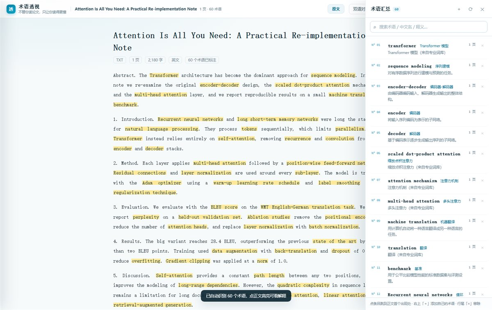
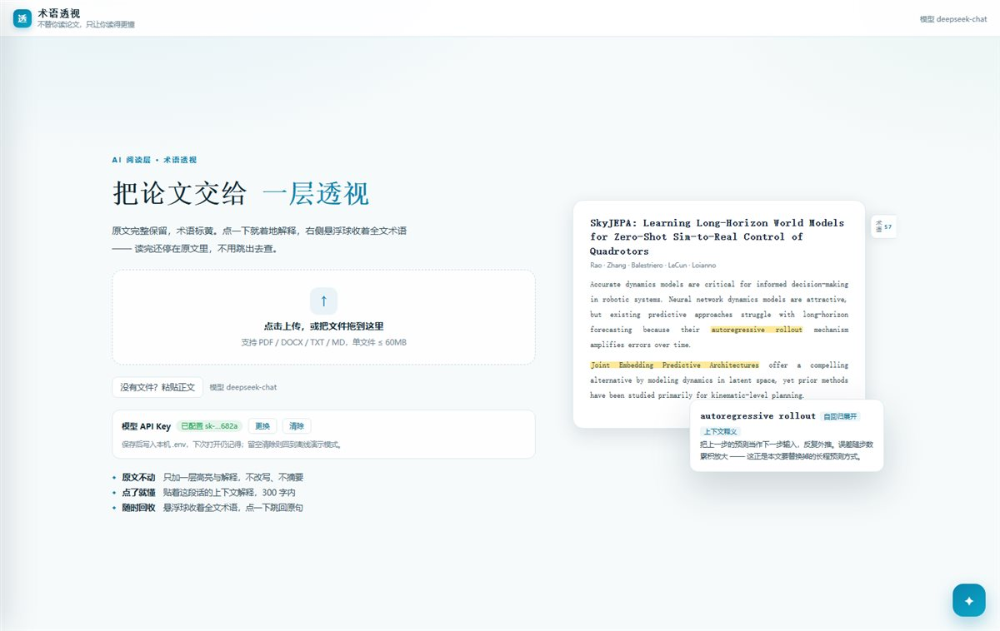
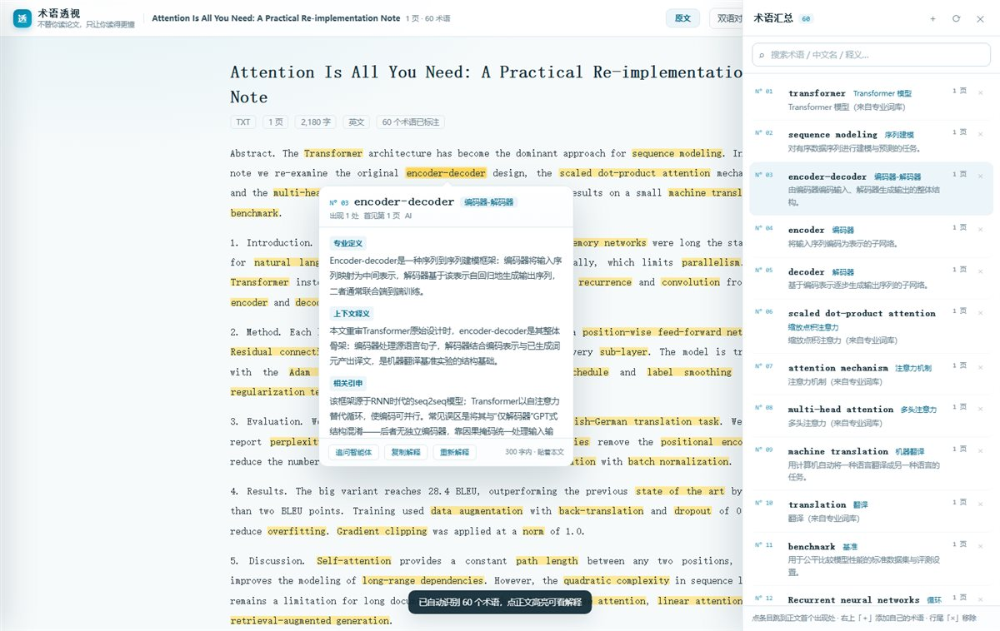
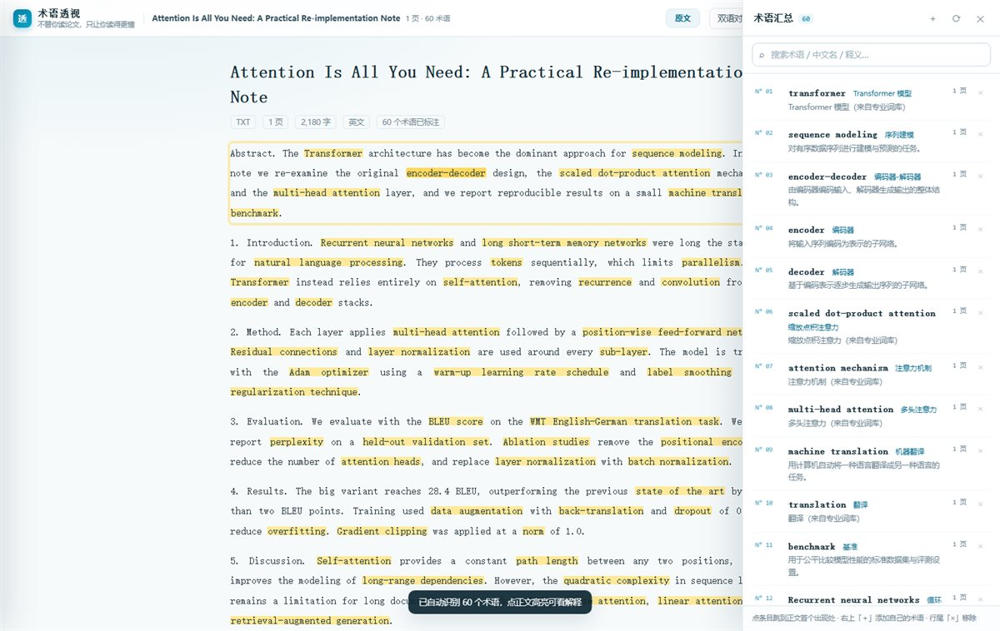
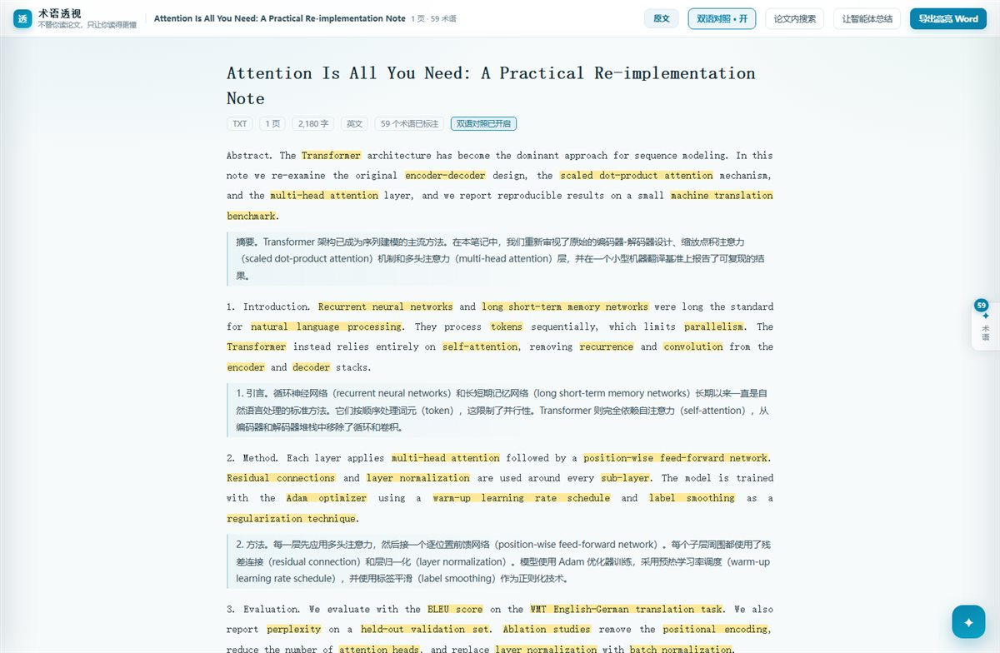
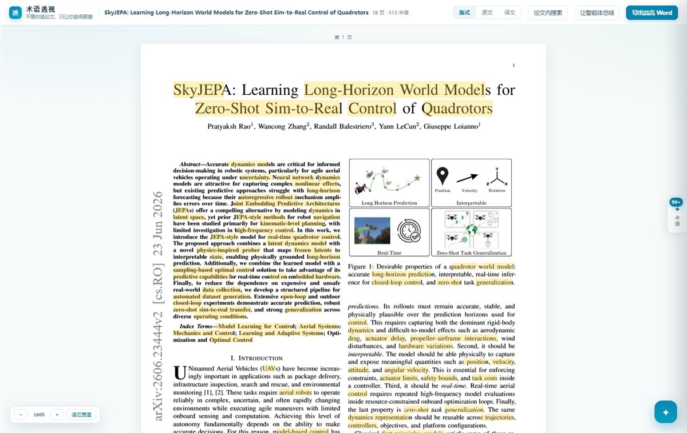
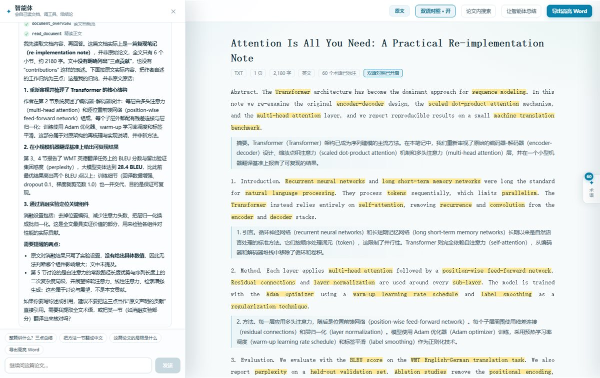
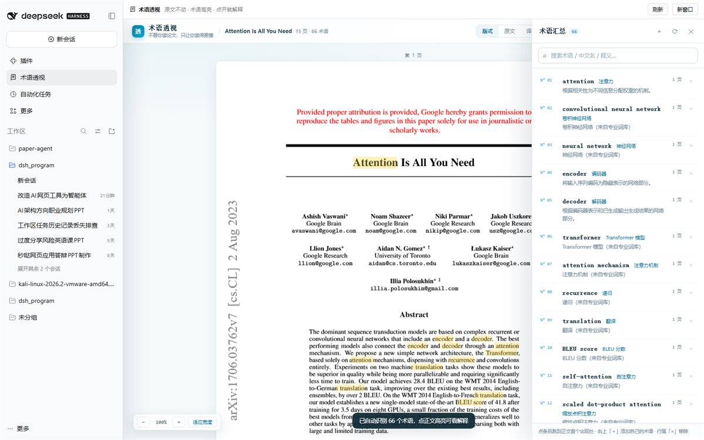

# 术语透视 · 论文术语分析助手

> 读论文时让人放弃的往往不是「读不懂」，而是「读不下去」。
> 这个工具在原文之上加一层透明解释：术语标黄，点一下就着地解释，读完还停在原文里。

[](LICENSE)
[](https://nodejs.org)
[](#已知限制)
[](docs/DSH插件说明.md)



English TL;DR — A local-first reading layer for academic papers: highlight terms, click for an
in-place explanation grounded in the paper's context, ask a tool-using agent, and read bilingually
(paragraph-by-paragraph translation) without leaving the page. Runs as a local Node app, a
portable Windows bundle, or a DeepSeek Harness plugin.

---

## 目录

- [它解决什么问题](#它解决什么问题)
- [功能](#功能)
- [界面速览](#界面速览)
- [快速开始](#快速开始)
- [架构](#架构)
- [模型配置](#模型配置)
- [接口](#接口)
- [成本控制：同一内容只问一次](#成本控制同一内容只问一次)
- [目录结构](#目录结构)
- [测试](#测试)
- [DeepSeek Harness 插件](#deepseek-harness-插件)
- [已知限制](#已知限制)
- [许可](#许可)

---

## 它解决什么问题

跨专业读论文时，一次查词通常要走六步：读到术语 → 复制 → 切窗口 → 搜百科 → 辨别义项 → 找回原句。
单次成本不大，但一篇论文可能触发几百次，注意力反复被打断；更麻烦的是百科给的是**领域通用义**，
未必是**这篇文章里的意思**。

所以这个项目不做摘要器，而是做**一层不改变原文的阅读皮肤**：

| 原则 | 具体做法 |
| --- | --- |
| 原文不动 | 不改写、不删减、不做摘要，交付物是「读懂的原文 + 术语表」 |
| 就地解释 | 解释气泡贴着被点的术语出现，不跳页、不弹新窗口 |
| 结论自下 | 只给依据与语境，判断留给读者 |
| 可回溯 | 每个术语都能跳回原句，PDF 版式保留原样 |

---

## 功能

| 能力 | 说明 |
| --- | --- |
| **术语识别（双引擎）** | 自建词库 182 条 + 缩写表 76 条做零成本兜底，再让大模型按块抽取新词；两路按归一化键融合去重，单篇长论文可识别 500+ 术语 |
| **正文高亮** | 术语在原文里标黄；单字母、文件名、配置键等低信息量词自动不铺，长文档不会整页发黄 |
| **就地解释气泡** | 点高亮 → 贴着的三段式解释（专业定义 / 上下文释义 / 相关引申），流式输出，300 字内，贴合本文语境 |
| **PDF 版式视图** | 原文件逐页 `canvas` 渲染，术语以坐标覆盖层高亮；双栏、公式、表格、页眉原样保留，支持 60%–260% 缩放 |
| **双语对照** | 顶栏开关，原文一段、译文一段交替插入；逐段流式生成，版式视图下开启会自动切到原文 |
| **选段解释** | 文本视图划选、PDF 视图框选 → 「解释选段 / 翻译 / 复制」，解释结合所在页上下文 |
| **术语面板** | 右侧悬浮球展开全文术语（按出现顺序），点条目跳回原句；读者可自行增删术语，删掉的重新识别不会复活 |
| **智能体抽屉** | 8 个工具自主编排：概览 / 精读 / 检索 / 术语抽取 / 术语解释 / 翻译 / 导出 / 术语表，过程透明可追溯 |
| **导出 Word** | 段落重建 + 黄色术语高亮 + 附录术语表，导出的高亮与界面一致 |
| **论文内搜索** | `Ctrl/⌘ + F`，命中计数与上/下一处，定位并闪烁整段 |
| **成本控制** | 术语解释、选段解释、双语译文三层缓存，同一内容只请求一次模型 |

---

## 界面速览

| 首页 | 术语气泡 |
| --- | --- |
|  |  |

| 术语面板（可增删） | 双语对照（原文一段 / 译文一段） |
| --- | --- |
|  |  |

| PDF 版式视图 | 智能体抽屉 |
| --- | --- |
|  |  |

---

## 快速开始

### 方式一：源码运行

```bash
git clone https://github.com/james-myzy/PaperAgent_TerminologyHelper.git paper-agent
cd paper-agent
npm install --ignore-scripts     # 见下方说明
cp .env.example .env             # 填 LLM_API_KEY；不填也能进离线演示模式
npm run build                    # 前端构建到 web/dist
npm start                        # → http://127.0.0.1:8787
```

> `--ignore-scripts` 是刻意的：esbuild 的 postinstall 会起子进程，在收紧的沙箱/CI 里容易失败，
> 而这个项目只用到它的打包能力。

环境要求：**Node.js ≥ 20**（开发用 24）。不填 Key 时进入**离线演示模式**：界面、高亮、气泡、


### 方式二：免安装便携版（Windows）

在本仓库的 **Releases** 页面下载 `paper-agent-portable-v1.0-win64.zip`（约 48 MB）：

1. 解压到任意目录；
2. 双击 `启动.bat`；
3. 浏览器自动打开（端口被占用会自动换，窗口里会打印实际地址）。

内置 Node 24 运行时与全部依赖，目标机器**不需要安装 Node.js / npm**。

### 方式三：DeepSeek Harness 插件

在 Harness 的「插件 → 添加插件」里填本地路径（或 `pnpm add file:<path>`），
左侧栏就会出现「术语透视」，阅读页挂在 Harness 自己的 Web 服务上，**不需要再填 API Key**。
详见 [docs/DSH插件说明.md](docs/DSH插件说明.md)。

---

## 架构

```
┌──────────────────────────── 浏览器 ────────────────────────────┐
│  首页/上传 │ 文本阅读（高亮 + 气泡） │ PDF 版式层 │ 术语面板 │ 智能体抽屉 │
└───────────────┬────────────────────────────────────────────────┘
                │ fetch / SSE
┌───────────────▼──────────────── 本地 Node 进程 ─────────────────┐
│  路由与静态资源                                                  │
│  ├─ 解析：PDF(pdfjs) / DOCX(mammoth) / TXT → 页 + 段 + 标题      │
│  ├─ 术语引擎：词库扫描 + 模型分块抽取 → 归一化合并 → 高亮配额      │
│  ├─ 解释：术语三段式 / 选段四段式（都走 SSE 流式）                │
│  ├─ 翻译：逐段双语（并发 3 批，段落哈希缓存）                     │
│  ├─ 导出：docx（段落重建 + 黄色高亮 + 术语表）                    │
│  └─ 智能体：8 工具循环（最多 6 步）+ 工具结果回写界面              │
│  状态：data/docs/<id>.json（术语 / 详解 / 选段 / 逐段译文）        │
└───────────────┬────────────────────────────────────────────────┘
                │ OpenAI 兼容协议（可换任意供应商）
┌───────────────▼──────────────── 模型服务 ──────────────────────┐
│  DeepSeek / 其他 OpenAI 兼容端点   或   DeepSeek Harness 的 ctx.llm │
└────────────────────────────────────────────────────────────────┘
```

规模：服务端约 **2,485 行**，前端约 **3,385 行**，零框架依赖（服务端只用 `docx` / `mammoth` / `pdfjs-dist`）。

---

## 模型配置

复制 `.env.example` 为 `.env`：

```ini
LLM_API_KEY=sk-...                       # 不填 → 离线演示模式
LLM_BASE_URL=https://api.deepseek.com/v1 # 任意 OpenAI 兼容地址
LLM_MODEL=deepseek-chat
```

其他方案：首页左下角「模型 API Key」直接填写，保存后写入本机 `.env`，立即生效。
作为 Harness 插件运行时，模型由 Harness 统一提供（页面会显示「由 DeepSeek Harness 提供」）。

---

## 接口

| 方法 | 路径 | 作用 |
| --- | --- | --- |
| GET | `/api/health`、`/api/config` | 运行配置（provider / model / 是否已配置 Key） |
| POST | `/api/settings` | 保存 API Key / Base URL / 模型名（写回 `.env`） |
| GET | `/api/documents` | 已导入文档列表 |
| POST | `/api/documents` | 上传文档（二进制 + `X-Filename`），返回解析结果 |
| GET | `/api/documents/:id` | 文档状态（页、术语、详解、逐段译文） |
| GET | `/api/documents/:id/file` | 原始文件（PDF 版式视图用） |
| POST | `/api/documents/:id/terms` | 重新识别术语 |
| POST | `/api/documents/:id/terms/custom` | 添加自定义术语 |
| DELETE | `/api/documents/:id/terms/:termId` | 删除术语（记录后不会被重新识别复活） |
| POST | `/api/documents/:id/explain` | 术语解释（SSE） |
| POST | `/api/documents/:id/explain-passage` | 选段解释（SSE，按内容缓存） |
| POST | `/api/documents/:id/translate-blocks` | 逐段翻译（SSE，双语对照用） |
| POST | `/api/documents/:id/export` | 导出带高亮的 Word |
| GET | `/api/exports/:name` | 下载导出文件 |
| POST | `/api/chat` | 智能体对话（SSE：step / tool / delta / state / done） |

---

## 成本控制：同一内容只问一次

| 内容 | 缓存键 | 效果 |
| --- | --- | --- |
| 术语解释 | 术语 id | 第二次点开 0 请求，刷新/重启仍命中 |
| 选段解释 | `页码 + 选段文字` 摘要 | 同一段重复选中直接回放 |
| 双语译文 | 段落文本哈希 | 译过的段落关掉再开不重复请求 |

想强制重算：术语气泡底部「重新解释」；选段解释按住 `Shift` 点「解释选段」。
实测：同一术语第二次点击请求数不变；15 页 / 191 段的论文整篇译完约 108 秒，重复打开不再计费。

---

## 目录结构

```
paper-agent/
├─ server/                服务端
│  ├─ index.mjs           路由、静态资源、SSE
│  ├─ parse.mjs           文档解析（PDF / DOCX / TXT）与块结构
│  ├─ store.mjs           文档状态（术语/详解/译文）持久化
│  ├─ config.mjs          .env 与环境变量
│  ├─ llm-transport.mjs   模型传输层插槽（插件注入 Harness 模型）
│  ├─ agent/              模型客户端、工具、提示词、术语引擎、智能体循环
│  └─ lib/                词库、术语匹配、Word 导出
├─ web/                   前端（React + Vite）
│  ├─ src/App.tsx         主界面与状态
│  ├─ src/components/     Reader / PdfReader / TermPanel / TermPopover / AgentSheet / FindBar
│  └─ vite.config.ts      支持 PAPER_BASE（插件构建用 /paper-agent/）
├─ dsh-plugin/            DeepSeek Harness 插件源码（宿主 + 浏览器两半）
├─ scripts/               自测与打包脚本
├─ docs/                  插件说明、便携版说明与截图
├─ launcher.mjs           便携版启动器（选端口、开浏览器）
└─ package.json
```

大文件说明：测试用的 PDF 样例、运行期数据都**不进仓库**（见 `.gitignore`）；
便携版与插件包放在 Releases。

---

## 测试

所有脚本都假设服务已在 `http://127.0.0.1:8787` 运行，且本机有 Chrome（Playwright 驱动）。

| 脚本 | 覆盖内容 |
| --- | --- |
| `scripts/smoke.mjs` | 智能体工具链端到端 |
| `scripts/reader-check.mjs` | 阅读器、气泡、面板、双语对照、智能体抽屉 |
| `scripts/bilingual-check.mjs` | 逐段翻译顺序 + 缓存命中（0 请求） |
| `scripts/explain-cache-check.mjs` | 术语解释缓存与 `force` 重算 |
| `scripts/passage-cache-check.mjs` | 选段解释缓存、不误用对话接口 |
| `scripts/term-locate-check.mjs` | 术语排序与定位（10/10） |
| `scripts/term-edit-check.mjs` | 术语增删与持久化 |
| `scripts/panel-jump-check.mjs` / `selection-check.mjs` | 面板跳转、划选/框选交互 |
| `scripts/pdf-native-check.mjs` | PDF 版式高亮与缩放 |
| `scripts/settings-check.mjs` | 首页填 Key 与自动识别 |

```bash
node scripts/reader-check.mjs   # 单个跑
```

---

## DeepSeek Harness 插件

同一套代码可以作为 DSH 插件运行：宿主半边把阅读页挂到 Harness 的 `/paper-agent` 前缀，
浏览器半边在左侧栏注册入口，模型调用桥接到 `ctx.llm`，并额外注册 7 个对话工具
（`paper_list` / `paper_open` / `paper_terms` / `paper_explain` / `paper_ask` / `paper_analyze` / `paper_import`）。



安装、配置、排错见 [docs/DSH插件说明.md](docs/DSH插件说明.md) 与 [dsh-plugin/README.md](dsh-plugin/README.md)。

---

## 已知限制

- **扫描件**（无文字层 PDF）不支持，需要先 OCR；
- 导出的 Word 保留段落与高亮，**不含表格 / 公式的结构化还原**；
- 双语对照是逐段串行排队生成的，长论文需要几分钟（译好的段落会立刻出现）；
- 阅读页是独立主题，不跟随 Harness 的深色模式（阅读区刻意保持浅色纸面）；
- 没有账号体系：文档、译文、导出都保存在本机 `data/`，换机器要自己拷。

---

---

## 许可

- 代码：[MIT](LICENSE)
- 主要开源组件：Node.js（MIT）、pdfjs-dist（Apache-2.0）、mammoth（BSD-2-Clause）、
  docx（MIT）、React（MIT）、Vite（MIT），各依赖的 LICENSE 随包保留；
- 模型服务：DeepSeek 开放平台（遵循其服务条款），本仓库**不包含**任何模型权重；
- 演示用论文为 arXiv 公开预印本，仅作输入样例，不随仓库分发。
